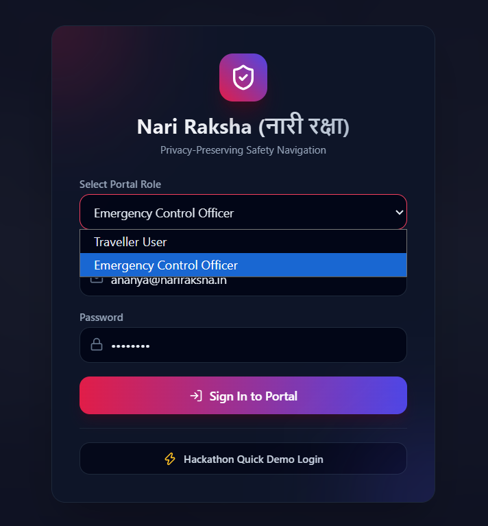
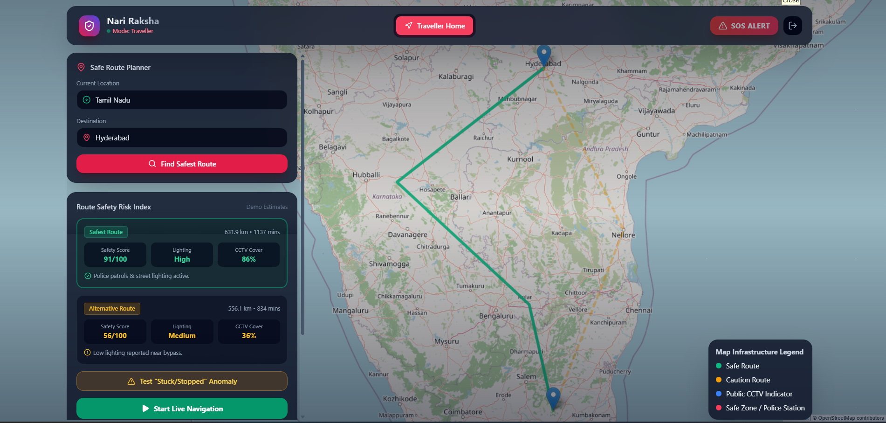
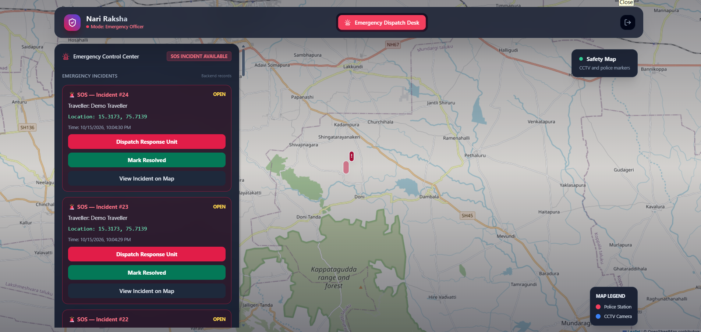
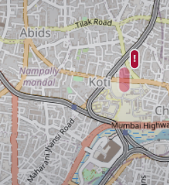

# 🛡️ Nari Raksha (नारी रक्षा)
### AI-Powered Women's Safety & Emergency Navigation System

Nari Raksha is a women's safety platform designed to support safer travel through route planning, emergency SOS alerts, and incident monitoring.

## ✨ Key Features

- 🗺️ Safe Route Planner
- 🚨 SOS Emergency Alert
- 📍 Incident Location Markers
- 👮 Emergency Control Officer Dashboard
- 📊 Incident Status Management
- 📱 Twilio SMS Integration (trial testing)
- 🗄️ MySQL Database for Incident Records

## 🖥️ Screenshots

### Login Page

### Traveller Dashboard

### Emergency Control Dashboard

### SOS Map Marker

## 🛠️ Technologies Used

- HTML
- CSS
- JavaScript
- Java
- Spring Boot
- MySQL
- Leaflet
- OpenStreetMap
- Twilio API

## 🚀 Running the Project

1. Install Java and MySQL.
2. Configure the database in `application.properties`.
3. Set the required Twilio environment variables if testing SMS.
4. Open the project in IntelliJ IDEA.
5. Run the Spring Boot application.
6. Open `http://localhost:8080/` in your browser.

## ⚠️ Important Notes

- Some safety scores, CCTV information, and route details are demonstration data.
- Twilio SMS functionality is subject to trial-account restrictions.
- This project is a prototype and should not be treated as a replacement for emergency services.

## 🤝 Acknowledgements

Special mention: [Gayathri](https://github.com/PATTIGAYATHRI)

## 👨‍💻 Project

**Nari Raksha — Technology for Safer Journeys**